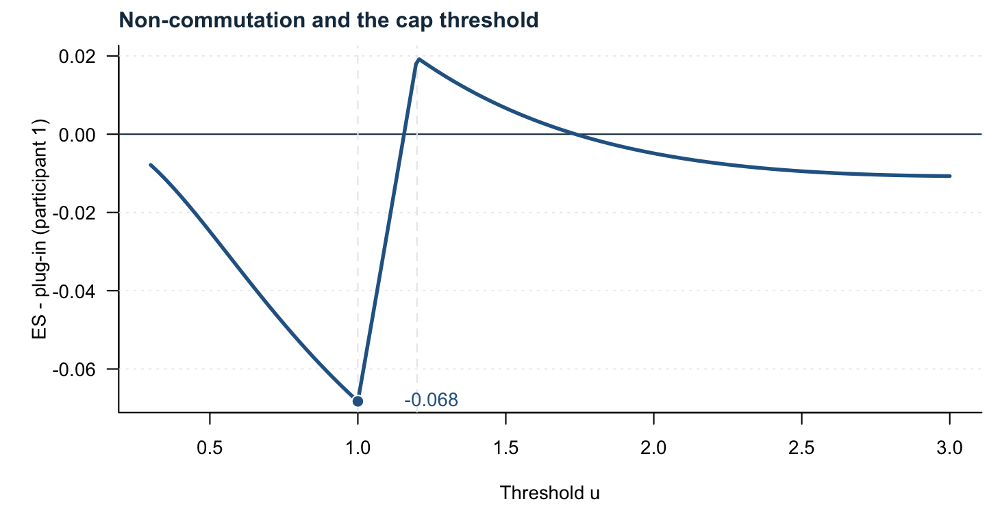
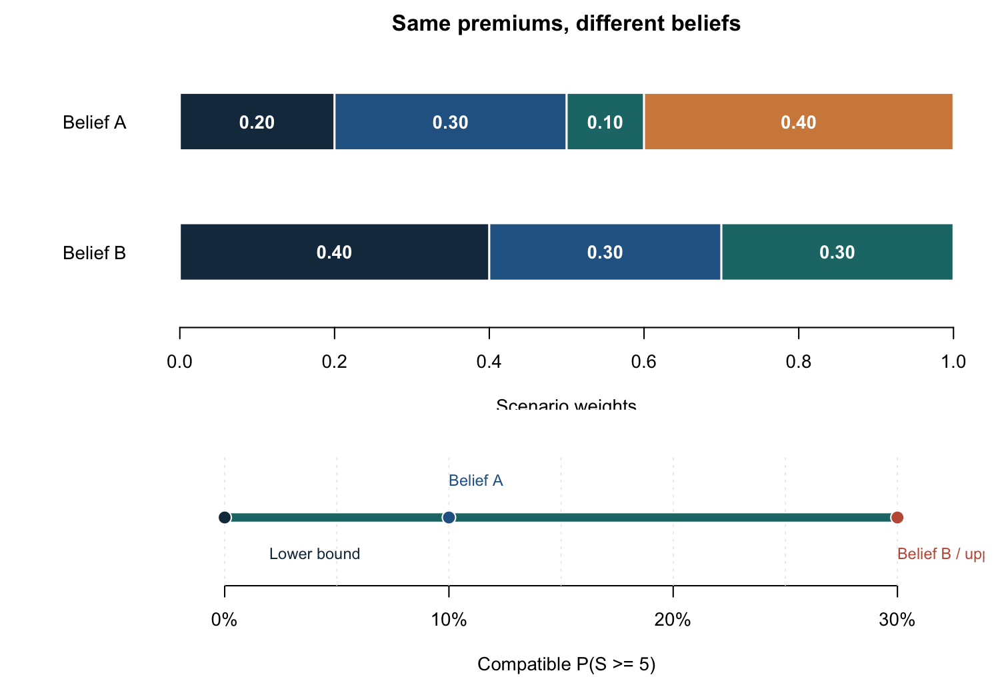
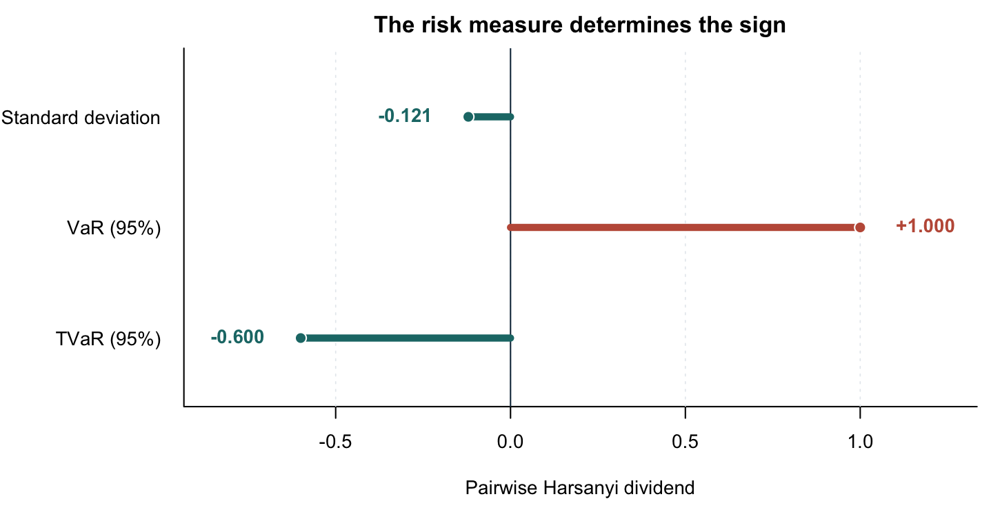
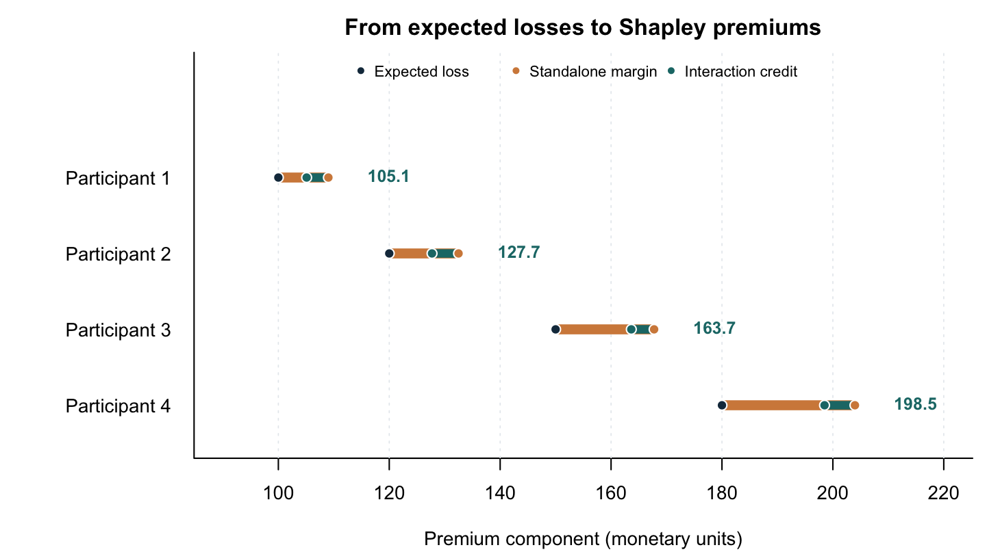
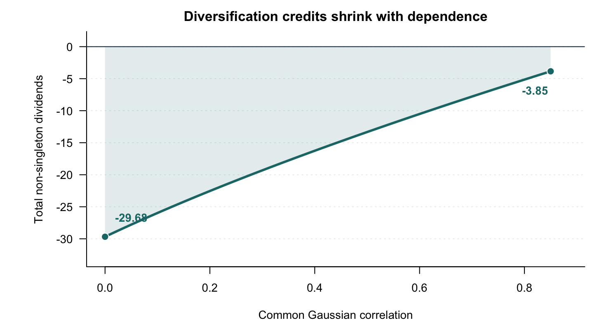
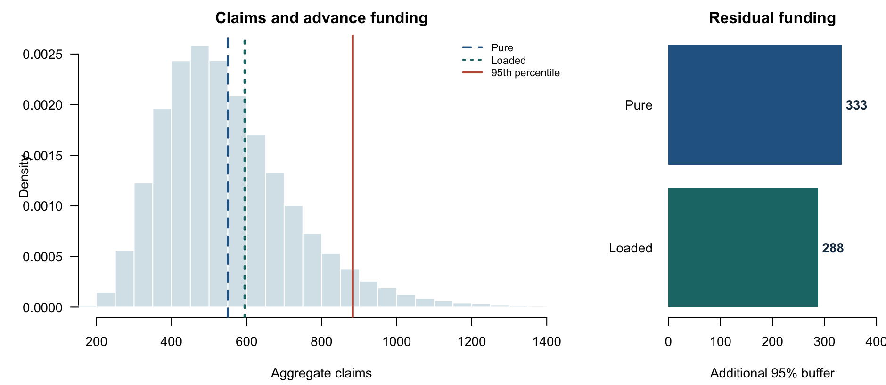

This document reproduces the numerical illustrations accompanying
*Ex Ante Premiums as Expected Risk-Sharing Allocations: Pricing Beliefs,
Cooperative Games, and Partial Identification*.

It is **self-contained**: the calculations below are copied from the supplied
`figures_R1_v2(1).R` script, with the same parameters, random seed and numerical
checks. No input data or special-purpose R libraries are needed. On rendering,
each table and figure appears **directly below the relevant experiment**. The
same code exports CSV tables and publication-ready PDF/PNG figures.

The code is foldable in the HTML report, but its outputs remain visible.
The only additional R package used for presentation is `knitr`, required by
Quarto's R engine.

## Initialization

The seed, colour scheme, output folders and plotting utilities come from the
original script. Output folders are created automatically in the directory
containing this document.


```{r}
#| label: setup
set.seed(20261015)
dir.create('figures_R1', showWarnings = FALSE)
dir.create('tables_R1', showWarnings = FALSE)
navy <- '#18354b'; blue <- '#286493'; teal <- '#1d7776'
gold <- '#d38949'; red <- '#c15b47'; gridc <- '#e6eaee'
cols <- c(navy, blue, teal, gold)

save_figure <- function(name, draw, width = 7.3, height = 4.5) {
  path <- file.path('figures_R1', name)
  for (kind in c('pdf','png')) {
    if (kind == 'pdf') grDevices::pdf(paste0(path,'.pdf'), width, height,
                                      family = 'Helvetica', pointsize = 10)
    else grDevices::png(paste0(path,'.png'), width=width,height=height,
                        units='in',res=200,pointsize=10)
    draw(); grDevices::dev.off()
  }
}
axis_grid <- function(vertical = TRUE) {
  if (vertical) abline(v = axTicks(1),col=gridc,lty=3,lwd=.8)
  else abline(h = axTicks(2),col=gridc,lty=3,lwd=.8)
}
```


## Expected sharing versus plug-in sharing

Two participants share losses above a common cap $u$. The allocation rule is

$$
H_i(\boldsymbol x)
=\min(x_i,u)+\frac12\sum_{j=1}^2(x_j-u)_+,
\qquad i=1,2.
$$

The losses are lognormal, with means $(1,1.2)$ and log-scale standard
deviations $(0.9,0.7)$. The computation uses the **exact lognormal stop-loss
expectation**, not Monte Carlo simulation. We compare

$$
\pi_i^{\mathrm{ES}}=\mathbb E[H_i(\boldsymbol X)],
\qquad
\pi_i^{\mathrm{PI}}=H_i(\mathbb E[\boldsymbol X]),
\qquad
\Gamma_i=\pi_i^{\mathrm{ES}}-\pi_i^{\mathrm{PI}}.
$$

The reported calibration is $u=1$; the supplementary figure varies $u$.


```{r}
#| label: compute-cap-premiums
# -- 1. Exact cap-and-mutualize premiums -----------------------------
ln_excess <- function(u,m,sigma) {
  mu <- log(m)-sigma^2/2
  m*pnorm((mu+sigma^2-log(u))/sigma) - u*pnorm((mu-log(u))/sigma)
}
cap_calc <- function(u,m=c(1,1.2),sigma=c(.9,.7)) {
  e <- mapply(function(mi,si) ln_excess(u,mi,si),m,sigma)
  det <- pmax(m-u,0)
  es <- m + mean(e)-e; pi <- m + mean(det)-det
  c(es1=es[1],es2=es[2],pi1=pi[1],pi2=pi[2],gap1=es[1]-pi[1])
}
cap <- cap_calc(1)
stopifnot(abs(sum(cap[c('es1','es2')])-2.2)<1e-9)
write.csv(data.frame(participant=c('1','2','Total'),
  expected=c(1,1.2,2.2),ES=c(cap['es1'],cap['es2'],sum(cap[c('es1','es2')])),
  PI=c(cap['pi1'],cap['pi2'],sum(cap[c('pi1','pi2')])),
  gap=c(cap['gap1'],-cap['gap1'],0)),
  'tables_R1/tab_R1_cap.csv',row.names=FALSE)
cap_grid <- seq(.3,3,length.out=251)
gap_grid <- vapply(cap_grid,function(u) cap_calc(u)['gap1'],numeric(1))
save_figure('fig_R1_cap_gap',function() {
  par(mar=c(4.1,5.2,2.0,.8),las=1,bty='l')
  plot(cap_grid,gap_grid,type='n',xlab='Threshold u',ylab='ES - plug-in (participant 1)',
       main='',ylim=range(c(gap_grid,0)))
  axis_grid(FALSE);abline(h=0,col=navy)
  abline(v=c(1,1.2),col=gridc,lty=2)
  lines(cap_grid,gap_grid,col=blue,lwd=2.6)
  points(1,cap['gap1'],pch=21,cex=1.4,bg=blue,col='white')
  text(1.12,cap['gap1'],sprintf('%+.3f',cap['gap1']),col=blue,pos=4)
  mtext('Non-commutation and the cap threshold',side=3,line=.6,adj=0,col=navy,font=2,cex=1.15)
},7.3,3.7)
```


```{r}
#| label: tbl-cap-premiums
#| echo: false
tab <- read.csv("tables_R1/tab_R1_cap.csv", check.names = FALSE)
knitr::kable(tab, digits = 4, caption = "Exact expected-sharing and plug-in premiums (cap $u=1$).")
```


```{r}
#| label: fig-cap-gap
#| echo: false
#| fig-cap: "Non-commutation gap for participant 1 as the cap changes. Dashed vertical lines indicate the marginal means $1$ and $1.2$."
#| out-width: "95%"

```


The two premiums sum to the same expected aggregate loss, but they
redistribute it differently. In this example the expected-sharing premiums
depend only on the **marginal** loss laws; their values do not depend on the
correlation between losses.


## Revealed pricing beliefs and identification

Consider three participants and four scenarios with individual responsibility:

$$
A=\begin{pmatrix}
1&0&2&1.5\\
1&2&1&1\\
0&2&3&1.5
\end{pmatrix},\qquad
\boldsymbol S=(2,4,6,4).
$$

Two pricing beliefs $\boldsymbol q^A=(0.2,0.3,0.1,0.4)$ and
$\boldsymbol q^B=(0.4,0.3,0.3,0)$ imply **the same premiums**:
$A\boldsymbol q^A=A\boldsymbol q^B=(1,1.3,1.5)^\top$.
The full set of compatible beliefs is

$$
\mathcal Q(\boldsymbol\pi;A)
=\left\{\left(0.2+\frac t2,\,0.3,\,0.1+\frac t2,\,0.4-t\right):
-0.2\le t\le0.4\right\}.
$$

Consequently the sharp implied range for the stress probability is
$0\le\Pr_{\boldsymbol q}(S\ge5)\le0.30$.

Next, on the **same scenarios**, a nonlinear cap-and-mutualize rule with $u=1$
produces a different allocation matrix $B$. Its augmented matrix has rank 4,
whereas the augmented matrix associated with $A$ has rank 3. The two beliefs
are therefore distinguishable under this alternative sharing rule.


```{r}
#| label: compute-revealed-beliefs
# -- 2. Revealed beliefs: exact finite-scenario example -------------
A <- cbind(c(1,1,0),c(0,2,2),c(2,1,3),c(1.5,1,1.5))
S <- colSums(A)
qa <- c(.2,.3,.1,.4); qb <- c(.4,.3,.3,0)
prema <- as.vector(A%*%qa); premb <- as.vector(A%*%qb)
stopifnot(max(abs(prema-premb))<1e-12)
q_t <- function(t) c(.2+t/2,.3,.1+t/2,.4-t)
stopifnot(max(abs(A%*%q_t(-.2)-prema))<1e-12,
          max(abs(A%*%q_t(.4)-prema))<1e-12)
write.csv(data.frame(scenario=1:4,t(A),total=S),
          'tables_R1/tab_R1_scenarios.csv',row.names=FALSE)
write.csv(data.frame(belief=c('A','B'),q1=c(qa[1],qb[1]),q2=c(qa[2],qb[2]),
  q3=c(qa[3],qb[3]),q4=c(qa[4],qb[4]),
  premium1=c(prema[1],premb[1]),premium2=c(prema[2],premb[2]),
  premium3=c(prema[3],premb[3]),stress_prob=c(qa[3],qb[3])),
  'tables_R1/tab_R1_beliefs.csv',row.names=FALSE)
# Same scenarios, nonlinear cap-and-mutualize sharing (u = 1)
cap_pool <- function(x, u = 1) {
  pmin(x, u) + sum(pmax(x-u, 0))/length(x)
}
B <- vapply(1:ncol(A), function(k) cap_pool(A[,k]), numeric(nrow(A)))
aug_rank <- function(X) qr(rbind(X, rep(1,ncol(X))))$rank
stopifnot(aug_rank(A)==3L, aug_rank(B)==4L,
          max(abs(colSums(B)-S))<1e-12)
pB_A <- as.vector(B %*% qa)
pB_B <- as.vector(B %*% qb)
stopifnot(max(abs(pB_A-c(1.133333333,1.433333333,1.233333333)))<1e-8,
          max(abs(pB_B-c(1.2,1.5,1.1)))<1e-12)
write.csv(data.frame(scenario=1:4,t(B),total=colSums(B)),
          'tables_R1/tab_R1_nonlinear_scenarios.csv', row.names=FALSE)
write.csv(data.frame(belief=c('A','B'),
          premium1=c(pB_A[1],pB_B[1]),
          premium2=c(pB_A[2],pB_B[2]),
          premium3=c(pB_A[3],pB_B[3])),
          'tables_R1/tab_R1_nonlinear_beliefs.csv', row.names=FALSE)

save_figure('fig_R1_revealed_beliefs',function() {
  op <- par(no.readonly=TRUE); on.exit(par(op))
  layout(matrix(c(1,2),2,1),heights=c(1.6,1.05))
  par(mar=c(3.7,6.7,2.1,.7),bty='n')
  plot(NA,xlim=c(0,1),ylim=c(.5,2.5),xlab='Scenario weights',ylab='',
       yaxt='n',main='Same premiums, different beliefs')
  axis(2,at=2:1,labels=c('Belief A','Belief B'),las=1,tick=FALSE)
  for (k in 1:2) {
    w <- if (k==1) qa else qb
    xleft <- 0; y <- 3-k
    for (j in seq_along(w)) if (w[j]>0) {
      rect(xleft,y-.22,xleft+w[j],y+.22,col=cols[j],border='white',lwd=1.4)
      if (w[j]>=.095) text(xleft+w[j]/2,y,sprintf('%.2f',w[j]),col='white',font=2)
      xleft <- xleft+w[j]
    }
  }
  legend('top',inset=c(0,-.26),legend=paste('Scenario',1:4),fill=cols,
         horiz=TRUE,bty='n',xpd=TRUE,cex=.82)
  par(mar=c(4.2,6.7,2,.7),bty='n')
  plot(NA,xlim=c(-.02,.325),ylim=c(0,1),xaxt='n',yaxt='n',xlab='Compatible P(S >= 5)',ylab='')
  axis(1,at=c(0,.1,.2,.3),labels=c('0%','10%','20%','30%'))
  axis_grid(TRUE); segments(0,.52,.3,.52,col=teal,lwd=6)
  points(c(0,.1,.3),rep(.52,3),pch=21,bg=c(navy,blue,red),col='white',cex=1.6)
  text(c(.02,.1,.3),c(.23,.83,.23),c('Lower bound','Belief A','Belief B / upper bound'),
       col=c(navy,blue,red),cex=.85,adj=c(0,.5,1))
},7.5,5.1)
```


```{r}
#| label: tbl-scenarios
#| echo: false
tab <- read.csv("tables_R1/tab_R1_scenarios.csv", check.names = FALSE)
knitr::kable(tab, digits = 2, caption = "Scenario allocations under individual responsibility.")
```


```{r}
#| label: tbl-beliefs
#| echo: false
tab <- read.csv("tables_R1/tab_R1_beliefs.csv", check.names = FALSE)
knitr::kable(tab, digits = 3, caption = "Two beliefs with the same premium vector under individual responsibility.")
```


```{r}
#| label: fig-revealed-beliefs
#| echo: false
#| fig-cap: "Two observationally equivalent beliefs and the sharp stress-probability interval from 0% to 30%."
#| out-width: "95%"

```


### Changing the sharing rule

For the nonlinear sharing rule $H_i(\boldsymbol x)=\min(x_i,1)
+\tfrac13\sum_j(x_j-1)_+$, the scenario allocations change. The code checks
that both matrices remain budget-balanced, but their augmented ranks differ.


```{r}
#| label: tbl-nonlinear-scenarios
#| echo: false
tab <- read.csv("tables_R1/tab_R1_nonlinear_scenarios.csv", check.names = FALSE)
knitr::kable(tab, digits = 3, caption = "Scenario allocations after cap-and-mutualize sharing.")
```


```{r}
#| label: tbl-nonlinear-beliefs
#| echo: false
tab <- read.csv("tables_R1/tab_R1_nonlinear_beliefs.csv", check.names = FALSE)
knitr::kable(tab, digits = 4, caption = "The same beliefs now generate different premium vectors.")
```


The non-identification in the first rule is intentional: the fourth column
is the midpoint of the first and third columns. The example isolates how a
sharing mechanism can change identification; **nonlinearity does not always
guarantee** point identification.


## Interaction dividends and the choice of risk functional

Consider two mutually exclusive Bernoulli losses. Each equals 1 with
probability $p=0.04$, and the events never occur together. For a risk
functional $K$, the pairwise Harsanyi dividend is

$$
d_K(\{1,2\})=K(X_1+X_2)-K(X_1)-K(X_2).
$$

The code computes this dividend for the standard deviation, 95% Value-at-Risk
and 95% Tail-Value-at-Risk. For the discrete distributions, TVaR is defined
as the upper-tail mean, including the fractional probability mass at the
quantile threshold.


```{r}
#| label: compute-risk-dividends
# -- 3. Analytic interaction dividends under SD / VaR / TVaR -------
p <- .04
sd_1 <- sqrt(p*(1-p));sd_pool <- sqrt(2*p*(1-2*p))
divs <- c(SD=sd_pool-2*sd_1, VaR95=1, TVaR95=1-2*.8)
stopifnot(divs[1]<0,divs[2]>0,divs[3]<0)
write.csv(data.frame(functional=names(divs),K_X1=c(sd_1,0,.8),
 K_X2=c(sd_1,0,.8),K_total=c(sd_pool,1,1),dividend=as.vector(divs)),
 'tables_R1/tab_R1_risk_dividends.csv',row.names=FALSE)
save_figure('fig_R1_risk_dividends',function() {
  par(mar=c(4.5,8.0,2.1,1.0),bty='l',las=1)
  plot(NA,xlim=c(-.85,1.25),ylim=c(.5,3.5),xlab='Pairwise Harsanyi dividend',
       ylab='',yaxt='n',main='The risk measure determines the sign')
  axis(2,at=3:1,labels=c('Standard deviation','VaR (95%)','TVaR (95%)'),
       las=1,tick=FALSE)
  axis_grid(TRUE);abline(v=0,col=navy,lwd=1)
  for (i in 1:3) {
    y<-4-i; c <- if (divs[i]>0) red else teal
    segments(0,y,divs[i],y,col=c,lwd=5)
    points(divs[i],y,pch=21,bg=c,col='white',cex=1.3)
    text(divs[i]+ifelse(divs[i]>0,.07,-.07),y,sprintf('%+.3f',divs[i]),
         pos=ifelse(divs[i]>0,4,2),col=c,font=2)
  }
},7.25,3.7)
```


```{r}
#| label: tbl-risk-dividends
#| echo: false
tab <- read.csv("tables_R1/tab_R1_risk_dividends.csv", check.names = FALSE)
knitr::kable(tab, digits = 3, caption = "Pairwise dividends under three risk functionals.")
```


```{r}
#| label: fig-risk-dividends
#| echo: false
#| fig-cap: "The same two risks produce negative standard-deviation and TVaR dividends but a positive VaR dividend."
#| out-width: "95%"

```


Here, VaR is not subadditive: neither individual loss reaches its 95th
percentile, while the aggregate does. By contrast, standard deviation and
TVaR produce negative pairwise interaction dividends.


## Risk-loaded Shapley premiums and dependence

Four lognormal risks have marginal means $(100,120,150,180)$ and log-scale
standard deviations $(0.35,0.40,0.45,0.50)$. Their Gaussian correlation
matrix is specified in the code. Coalition values are defined by the
**ex ante risk-loaded game**

$$
v(C)=\mathbb E[S_C]+\lambda\operatorname{sd}(S_C),
\qquad\lambda=0.25,
\qquad S_C=\sum_{i\in C}X_i.
$$

The covariance and all 15 nonempty coalition values are computed
**analytically**. The code then computes their Harsanyi dividends and
Shapley allocations and verifies efficiency numerically. The decomposition is

$$
\operatorname{Sh}_i(v)
=\mathbb E[X_i]
+\lambda\operatorname{sd}(X_i)
+\sum_{C\ni i,\,|C|\ge2}\frac{d_v(C)}{|C|}.
$$

Unlike the fixed scenario-allocation construction $\boldsymbol\pi=A\boldsymbol q$,
this standard-deviation-loaded game depends nonlinearly on the pricing belief.


```{r}
#| label: compute-shapley-dependence
# -- 4. Lognormal games and sensitivity to Gaussian dependence ------
m <- c(100,120,150,180);sig <- c(.35,.40,.45,.50);lambda <- .25
Robs <- matrix(c(1,.55,.20,.10,.55,1,.25,.15,.20,.25,1,.60,.10,.15,.60,1),4,4,byrow=TRUE)
stopifnot(min(eigen(Robs,symmetric=TRUE)$values)>0)
member <- function(mask) which(bitwAnd(mask,bitwShiftL(1L,0:3))!=0L)
calc_game <- function(R) {
  covmat <- outer(m,m)*expm1(outer(sig,sig)*R)
  v <- numeric(16)
  for (mask in 1:15) {
    ids <- member(mask)
    v[mask+1] <- sum(m[ids])+lambda*sqrt(sum(covmat[ids,ids,drop=FALSE]))
  }
  d <- numeric(16)
  for(mask in 1:15) {
    subsets <- 0:15
    subsets <- subsets[bitwAnd(subsets,mask)==subsets]
    d[mask+1] <- sum((-1)^(length(member(mask))-vapply(subsets,
      function(b) length(member(b)),integer(1)))*v[subsets+1])
  }
  sh <- vapply(1:4,function(i) {
    coal <- 1:15
    coal <- coal[bitwAnd(coal,bitwShiftL(1L,i-1))!=0L]
    sum(d[coal+1]/vapply(coal,function(b) length(member(b)),integer(1)))
  },numeric(1))
  singleton <- v[2^(0:3)+1]
  stopifnot(abs(sum(sh)-v[16])<1e-8)
  list(covmat=covmat,v=v,d=d,sh=sh,singleton=singleton,
       sd=sqrt(sum(covmat)),interaction=v[16]-sum(singleton))
}
r0 <- diag(4);r85 <- matrix(.85,4,4);diag(r85)<-1
ind <- calc_game(r0);obs <- calc_game(Robs);strong <- calc_game(r85)
write.csv(data.frame(participant=1:4,expected=m,
  standalone_margin=obs$singleton-m,interaction_credit=obs$sh-obs$singleton,
  shapley_premium=obs$sh),'tables_R1/tab_R1_shapley.csv',row.names=FALSE)
write.csv(data.frame(dependence=c('Independent','Baseline','Equicorrelation 0.85'),
  sd=c(ind$sd,obs$sd,strong$sd),risk_loaded_total=c(ind$v[16],obs$v[16],strong$v[16]),
  interaction=c(ind$interaction,obs$interaction,strong$interaction)),
  'tables_R1/tab_R1_dependence.csv',row.names=FALSE)
save_figure('fig_R1_premium_components',function() {
  par(mar=c(4.2,8.5,2.3,1.2),bty='l',las=1)
  plot(NA,xlim=c(90,220),ylim=c(.5,5.45),xlab='Premium component (monetary units)',
       ylab='',yaxt='n',main='From expected losses to Shapley premiums')
  axis(2,at=4:1,labels=paste('Participant',1:4),las=1,tick=FALSE)
  axis_grid(TRUE)
  for(i in 1:4) {
    y<-5-i
    segments(m[i],y,obs$singleton[i],y,lwd=7,col=gold)
    segments(obs$singleton[i],y,obs$sh[i],y,lwd=6,col=teal)
    points(c(m[i],obs$singleton[i],obs$sh[i]),rep(y,3),pch=21,
           bg=c(navy,gold,teal),col='white',cex=1.15)
    text(obs$singleton[i]+5,y,sprintf('%.1f',obs$sh[i]),col=teal,pos=4,font=2,cex=.9)
  }
  legend('top',legend=c('Expected loss','Standalone margin','Interaction credit'),
         col=c(navy,gold,teal),pch=16,horiz=TRUE,bty='n',cex=.8)
},7.3,4.05)
rho <- seq(0,.85,length.out=160)
interact <- vapply(rho,function(x) {
  R <- matrix(x,4,4);diag(R)<-1
  calc_game(R)$interaction
},numeric(1))
save_figure('fig_R1_dependence',function() {
  par(mar=c(4.25,6.3,2.3,1.25),bty='l',las=1)
  plot(rho,interact,type='n',xlim=c(0,.88),ylim=c(-33,1),
       xlab='Common Gaussian correlation',ylab='Total non-singleton dividends',
       main='Diversification credits shrink with dependence')
  axis_grid(FALSE);abline(h=0,col=navy,lwd=1)
  polygon(c(rho,rev(rho)),c(interact,rep(0,length(interact))),
          col=adjustcolor(teal,alpha.f=.13),border=NA)
  lines(rho,interact,col=teal,lwd=2.8)
  points(c(0,.85),c(interact[1],tail(interact,1)),pch=21,bg=teal,col='white',cex=1.4)
  text(c(.05,.82),c(interact[1]+3,tail(interact,1)-3),
       sprintf('%.2f',c(interact[1],tail(interact,1))),col=teal,font=2)
},7.3,3.95)
```


```{r}
#| label: tbl-shapley
#| echo: false
tab <- read.csv("tables_R1/tab_R1_shapley.csv", check.names = FALSE)
knitr::kable(tab, digits = 2, caption = "Exact loss, stand-alone margin, interaction credit and Shapley premium.")
```


```{r}
#| label: fig-premium-components
#| echo: false
#| fig-cap: "Composition of Shapley premiums: expected losses, stand-alone risk margins and diversification credits."
#| out-width: "95%"

```


### Sensitivity to dependence

Keeping the marginal laws fixed, we compare independence, the baseline
correlation matrix and equicorrelation $\rho=0.85$. The total non-singleton
dividend is

$$
v(N)-\sum_i v(\{i\})
=\lambda\left(\operatorname{sd}(S_N)
-\sum_i\operatorname{sd}(X_i)\right).
$$


```{r}
#| label: tbl-dependence
#| echo: false
tab <- read.csv("tables_R1/tab_R1_dependence.csv", check.names = FALSE)
knitr::kable(tab, digits = 2, caption = "Dependence sensitivity of aggregate risk-loaded cost and interaction credits.")
```


```{r}
#| label: fig-dependence
#| echo: false
#| fig-cap: "Increasing equicorrelation reduces the portfolio diversification credit while the marginal loss distributions remain unchanged."
#| out-width: "95%"

```


## Advance contributions and one-period financing

We return to the four-risk lognormal portfolio. This is the **only Monte Carlo
experiment** in the document: 200,000 portfolio realizations, with the fixed
seed `20261015`. The code calculates the empirical 95% claims quantile, the
pure contribution $\mathbb E[S_N]$, the loaded contribution $v(N)$ and the
additional one-period buffer above each contribution.

These buffers are illustrative financing quantities, **not** regulatory
capital requirements. Monte Carlo results are approximate; the exact game
calculations of the preceding section remain separate.


```{r}
#| label: compute-one-period-financing
# -- 5. One-period funding, on the same fixed R sample as the QMD ----
set.seed(20261015); Nsim <- 200000L
z <- matrix(rnorm(Nsim*4L),ncol=4L)
logloss <- sweep(z%*%chol(Robs),2,sig,'*')
logloss <- sweep(logloss,2,log(m)-sig^2/2,'+')
loss_total <- rowSums(exp(logloss))
pure <- sum(m); loaded <- obs$v[16]
q95 <- as.numeric(quantile(loss_total,.95,type=1))
funding <- data.frame(quantity=c('Expected aggregate claims','Loaded contribution',
  'VaR 95 percent','Buffer above pure','Buffer above loaded'),
  value=c(pure,loaded,q95,q95-pure,q95-loaded))
write.csv(funding,'tables_R1/tab_R1_financing.csv',row.names=FALSE)
save_figure('fig_R1_financing',function() {
  op <- par(no.readonly=TRUE);on.exit(par(op))
  layout(matrix(1:2,nrow=1),widths=c(1.9,1))
  par(mar=c(4.3,5.0,2.25,1.0),las=1,bty='l')
  hist(loss_total,breaks=80,freq=FALSE,col='#d8e4ea',border='white',
       xlim=c(200,1400),xlab='Aggregate claims',ylab='Density',
       main='Claims and advance funding')
  abline(v=pure,col=blue,lty=2,lwd=2.3)
  abline(v=loaded,col=teal,lty=3,lwd=2.5)
  abline(v=q95,col=red,lwd=2.3)
  legend('topright',legend=c('Pure','Loaded','95th percentile'),
         col=c(blue,teal,red),lty=c(2,3,1),lwd=2,bty='n',cex=.80)
  par(mar=c(4.3,5.6,2.25,.6),las=1,bty='l')
  bp<-barplot(c(q95-loaded,q95-pure),names.arg=c('Loaded','Pure'),
       horiz=TRUE,col=c(teal,blue),border=NA,xlim=c(0,400),
       xlab='Additional 95% buffer',main='Residual funding')
  text(c(q95-loaded,q95-pure)+8,bp,sprintf('%.0f',c(q95-loaded,q95-pure)),
       adj=0,col=navy,font=2)
},9.4,4.1)
cat('Reproduced: premiums', paste(round(prema,2),collapse=', '),
    '| stress probability bounds [0,0.30] | VaR95=',round(q95,2),'\n')
```


```{r}
#| label: tbl-financing
#| echo: false
tab <- read.csv("tables_R1/tab_R1_financing.csv", check.names = FALSE)
knitr::kable(tab, digits = 2, caption = "Simulated one-period claims quantile, contributions and additional illustrative buffers.")
```


```{r}
#| label: fig-financing
#| echo: false
#| fig-cap: "Distribution of aggregate losses, contribution benchmarks, 95% quantile and residual financing buffers."
#| out-width: "100%"

```


## Exported files and reproducibility

A successful render produces:

- `tables_R1/`: CSV files for every numerical table above.
- `figures_R1/`: the six graphics in both **PNG** (for this HTML report)
  and **vector PDF** (for the journal manuscript).
- This HTML report, with the figures and tables **embedded in the page**.

The original program's numerical inputs, `stopifnot()` checks, random seed,
plotting functions and file names are retained. This notebook has no external
data dependency and does not call `source()` on another R script.

Render from a shell in the directory containing this file:

```bash
quarto render insurance_premiums_reproducibility.qmd --to html
```

To obtain an optional PDF version (requires a LaTeX installation):

```bash
quarto render insurance_premiums_reproducibility.qmd --to pdf
```

